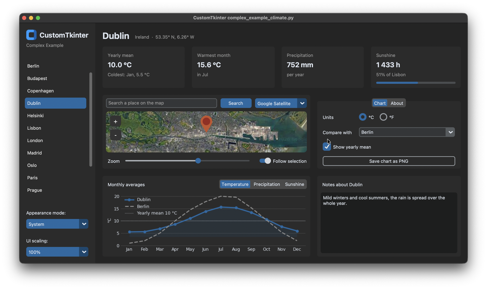

# CustomTkinter

CustomTkinter is a Python UI library based on Tkinter, which provides new, modern and fully customizable widgets.
They are created and used like normal Tkinter widgets and can also be used in combination with normal Tkinter elements.
The widgets and windows adapt to the system appearance or the manually set mode ('light', 'dark'),
and they support HighDPI scaling. With CustomTkinter you'll get a consistent and modern look on Windows, macOS and Linux.



## Installation

```
pip install customtkinter
```

## Example

```python
import customtkinter

customtkinter.set_appearance_mode("system")  # Modes: system (default), light, dark
customtkinter.set_default_color_theme("blue")  # Themes: blue (default), dark-blue, green

app = customtkinter.CTk()
app.geometry("400x240")

def button_function():
    print("button pressed")

button = customtkinter.CTkButton(app, text="CTkButton", command=button_function)
button.place(relx=0.5, rely=0.5, anchor=customtkinter.CENTER)

app.mainloop()
```

To see all available widgets, run:

```python
import customtkinter
customtkinter.run_showroom()
```

## Links

- Website and documentation: https://customtkinter.tomschimansky.com
- Tutorials: https://customtkinter.tomschimansky.com/tutorial
- Source code, issues and examples: https://github.com/TomSchimansky/CustomTkinter
- Changelog: https://github.com/TomSchimansky/CustomTkinter/blob/master/CHANGELOG.md
